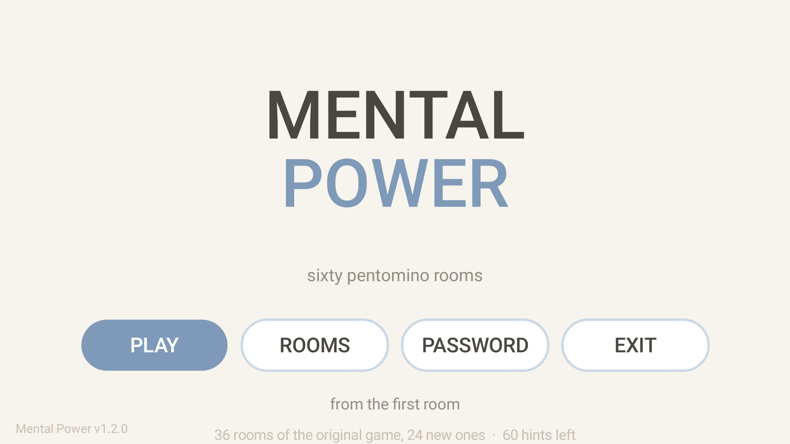
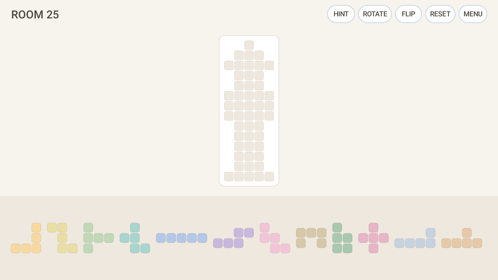

# Mental Power

A colour, landscape remake of the 1990 Game Boy puzzle game **Daedalian Opus** (Vic Tokai) as an
Android app. All 36 rooms, the twelve pentomino pieces plus the square that arrives for the last
room, the original room passwords — and nothing in between: no island map, no bridge building,
no storyline. Solving a room takes you straight to the next one.




## What is in the box

* **60 rooms.** Rooms 1-36 are the original game, in order, with the original shapes: the plain
  rectangles of the first few rooms, then the odd shapes — the rocket, the pistol, the enlarged
  pentominoes — and the 8x8 square for room 36. Rooms 37-60 are **24 new puzzles** made for this
  app, each one a shape that the pieces it hands out are known to fill.
* **The authentic piece sets.** A room hands you the pieces the original game handed you, and some
  rooms give you more pieces than you need, exactly as the Game Boy did.
* **The original passwords**: KING, EASY, NICE, BORN … STAR, FINE. Type one on the password screen
  to jump straight to that room. The word `ZEAL` unlocks the room select, as it did in 1990.
* **One hint per room.** If a room has you beaten, HINT puts one correct piece on the board for
you. Each room allows it once, so there are sixty hints across the game; the title screen shows
how many you have left. A hint is only spent if a piece could actually be placed, and it never
leaves a room unwinnable.
* **Progress that survives closing the app**: the furthest room you have reached.
* **Colour**: every pentomino has its own soft colour, so a half finished room reads at a glance.
* **No clock.** Rooms are not timed; nothing is counting at you.

## How to play

Drag a piece out of the tray at the bottom and drop it on the board. The outline under your finger
turns green where the piece fits and red where it does not. Fill every cell of the shape to clear
the room.

| Action | How |
| --- | --- |
| Pick up / move a piece | Drag it from the tray, or drag it off the board |
| Turn a piece | Tap it in the tray, or tap it once it is on the board |
| Mirror a piece | **FLIP** in the top bar turns the selected piece over |
| Turn the selected piece | **ROTATE** in the top bar |
| Put every piece back | **RESET** |
| Get one piece placed for you | **HINT** (once per room) |
| Back to the title screen | **MENU**, or the system back button |
| Leave the app | **EXIT** on the title screen, or back again from there |

Tapping a piece on the board turns it in place; if it no longer fits where it is, it stays put and
you can drag it off instead.

## Building it

The project is a plain Gradle Android project with no third party runtime dependencies — the whole
game is drawn on a `Canvas` by `GameView.kt`.

```sh
./gradlew assembleDebug          # app/build/outputs/apk/debug/app-debug.apk
./gradlew testDebugUnitTest      # the level data and the touch handling
```

Requires JDK 17 and the Android SDK with platform 34 and build tools 34.0.0. `app-debug.apk` in the
root of the repository is a build of this source.

To install it on a phone over USB:

```sh
adb install -r app-debug.apk
```

It is a debug build signed with the standard debug key, which is fine for sideloading on your own
device and is not accepted by Google Play.

## The new rooms

The 24 rooms after the original game are generated: a shape is grown symmetrically on a grid so it
reads as a designed silhouette rather than a blob, and it is kept only if a solver can tile it
exactly with a subset of the twelve pentominoes. Each new room hands you exactly the pieces its
solution needs — no spares — which makes them harder than the early rooms of the original game.
Their passwords are ordinary four letter words too (BOLD, CALM, DUSK ... BEAM, DRUM).

`LevelsTest` solves all sixty rooms through the same `Room` class the game plays with, so a new
room that cannot be filled would fail the build.

## Where the rooms come from

The shapes and piece sets of rooms 1-36 were taken from the level data of
[Puzzle Land](https://github.com/joyrider3774/puzzleland_embedded), a faithful C remake of the
original game, and cross-checked against the room dimensions listed in
[DEngel's walkthrough](https://gamefaqs.gamespot.com/gameboy/585678-daedalian-opus/faqs/44072) and
the original manual. `LevelsTest` proves that every one of the 36 rooms can be filled by the pieces
that room hands out, by solving all of them through the same `Room` class the game uses.

## The code

| File | What it does |
| --- | --- |
| `Levels.kt` | the 36 rooms and the 13 piece shapes, as small ASCII grids |
| `Model.kt` | pieces and their rotations, the board of a room, the placement rules, layout maths |
| `GameView.kt` | drawing and touch: title, password, room select, the puzzle, the room cleared panel |
| `Palette.kt` | the soft colour palette |
| `MainActivity.kt` | the single activity, landscape and full screen |

The tests in `app/src/test` cover the level data (`LevelsTest`), the touch handling
(`InteractionTest`) and, given `-Dshot.dir=<dir>`, render every screen to a PNG (`ScreenshotTest`).

## Credits

Daedalian Opus is the work of Vic Tokai. This is a personal, non commercial tribute that will only
ever run on its author's own phone; it is not on Google Play and contains no assets from the
original game — every shape, colour and sound here is drawn in code.
